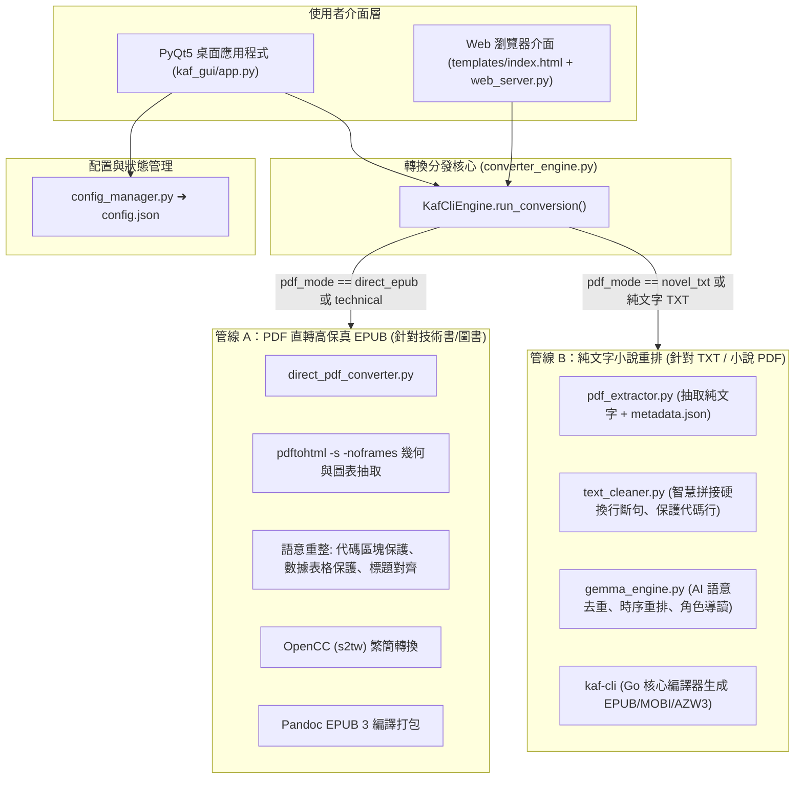

# kaf-cli 繁體中文電子書轉換器 - 專案需求與開發進度交接紀錄 (Project Handoff)

**存檔時間**：2026-10-15  
**工作目錄**：`/home/keith/OneDrive/script/kaf-cli`  
**核心定位**：基於 Go `kaf-cli` 的現代化繁體中文電子書（EPUB / MOBI / AZW3）桌面 GUI 與 Web 處理工作站，支援純文字小說與高保真 PDF 雙管線轉檔、Embedding Gemma 2 語意分析重排、O'Reilly 風格封面生成及自動化設定持久化。

---

## 一、歷次使用者需求與解決方案總覽 (User Requirements & Implementation)

| 編號 | 使用者需求描述 | 解決狀態 | 關鍵技術實作與檔案 |
| :--- | :--- | :---: | :--- |
| **Req 1** | GUI 介面過高過寬，無法適應螢幕，需具備自適應與大小調節 | ✅ 完成 | 於 `kaf_gui/app.py` 中引入 `QScreen.availableGeometry()` 自適應比例計算，設定最小視窗 640x440，分頁全面改為 `QScrollArea` 滾動容器，底部指示器緊湊化，並支援視窗大小記憶。 |
| **Req 2** | 不僅支援小說 txt，需支援含文字之 PDF，且涵蓋通用人文社科與技術手冊 | ✅ 完成 | 建立多書籍類型架構（`auto`、`story`、`general`、`technical`），整合 `pdftotext` 智慧抽取與段落修復。 |
| **Req 3** | 啟動時出現警告：`QSocketNotifier: Can only be used with threads started with QThread` 及 Wayland `requestActivate()` | ✅ 完成 | 重構所有背景執行緒為標準 `QThread`，清理非主執行緒事件循環與 Wayland 啟動旗標。 |
| **Req 4** | 使用 Gemma 2 識別語句與段落結構，提供時序重排、語意去重與登場角色導讀 | ✅ 完成 | 開發 `kaf_gui/gemma_engine.py`，支援 Ollama 及輕量級本地語意引擎雙後端，自動提煉登場人物列表、世界觀時代背景導讀並嵌入電子書前言。 |
| **Req 5** | 拖曳檔案進 GUI 時介面卡頓 (freeze)，需顯示非同步背景分析進度 | ✅ 完成 | 開發 `FileScanWorker(QThread)`，拖入檔案即刻回傳，背景非同步分析編碼、標題、大綱與推薦正則，並帶有即時百分比進度條。 |
| **Req 6** | 匯出 PDF 時若包含內嵌章節大綱，生成伴生 `metadata.json` 並還原章節位置 | ✅ 完成 | 開發 `kaf_gui/pdf_extractor.py`，解析 PDF 原始目錄樹並輸出 `{書名}_metadata.json`，於轉換時熔合大綱結構。 |
| **Req 7** | 應用程式需完整記憶使用者所有勾選與設定參數 | ✅ 完成 | 開發 `kaf_gui/config_manager.py`，配置防抖定時器（500ms），自動同步儲存所有控制項狀態至 `kaf_gui/config.json`，並支援命名預設方案（Presets）。 |
| **Req 8** | 書名過長時無法容納於封面 (Title can't fit the cover) | ✅ 完成 | 於 `kaf_gui/cover_generator.py` 重寫動態字級收縮演算法，長標題自動折行與自適應字型縮小，確保絕不溢出邊框。 |
| **Req 9** | PDF 預覽章節功能在特定書籍上報錯 | ✅ 完成 | 修復 `ChapterPreviewDialog` 與正則預覽邏輯，相容 PDF 內嵌大綱多層樹狀節點與扁平章節，缺失標題時自動回退正則分析。 |
| **Req 10** | PDF 直轉 EPUB 是否比轉 TXT 更能保持排版？（代碼行、表格、圖片嚴重黏連問題） | ✅ 完成 | 徹底確認並實作 **PDF 直轉 EPUB 高保真引擎**（`direct_pdf_converter.py`），利用 `pdftohtml` + 語意重構 + `pandoc`，完整保留代碼 monospace 區塊、數據表格與內嵌圖表，並於 GUI/Web 增加 `pdf_mode`。 |
| **Req 11** | LaTeX 數學公式轉換增強（技術書籍/學術論文中數學公式排版不失真） | ✅ 完成 | 於 `direct_pdf_converter.py` 整合 Pandoc `--mathml` (EPUB 3 原生矢量標準)，擴充 `convert_text_preserving_math` 隔離保護行內/行間公式，OpenCC 簡繁轉換時絕不破壞 LaTeX 關鍵字與標籤，並於 CSS 注入 MathML 專屬響應式樣式。 |
| **Req 12** | 多頁 PDF 直轉進度條細分（原本 15%~40% 期間無進度反饋） | ✅ 完成 | 於 `direct_pdf_converter.py` 中引入 `subprocess.Popen` 即時解析 `pdftohtml` 的 `Page-N` stdout 串流，結合總頁數動態計算 10%~40% 的逐頁即時百分比，並於語意重構階段細分段落重排進度。 |
| **Req 13** | Web 介面淺色/深色主題切換（桌面端已有，Web 端需補齊） | ✅ 完成 | 於 `templates/index.html` 構建完整的 `[data-theme="light"]` CSS 變數體系，頂部 header 新增主題切換按鈕，透過 JavaScript 與 `localStorage` 實現自動持久化與即時平滑切換。 |

---

## 二、軟體核心架構與檔案清單 (Architecture & File Map)



### 關鍵模組說明：
1. **`kaf_gui/app.py`**：桌面 GUI 主程式（PyQt5），包含 7 大設定分頁、即時指令預覽、4 階段 Pipeline 指示列、背景多執行緒掃描與非同步轉換 Worker。
2. **`kaf_gui/converter_engine.py`**：核心轉換排程器，負責參數組裝、執行檔探測、PDF 模式分發（直轉 vs 小說重排）與進度回報。
3. **`kaf_gui/direct_pdf_converter.py`**：次世代幾何座標與語意高保真 PDF 轉換引擎（Pandoc + pdftohtml / Calibre 雙核心）：
   - **字型樣式解析**：從 Poppler CSS 解析字級與等寬字體（Courier, Consolas, Monaco 等），精確識別正文字號與代碼區塊。
   - **幾何座標表格熔合**：基於 `top` 與 `left` 幾何座標空間融合多欄數據，自動重組成響應式標準 HTML `<table>`。
   - **頁首頁尾與頁碼自動濾除**：以相對頂部（$\le 8\%$）與底部（$\ge 90\%$）高度判斷，消除 Running Headers 與頁碼阻斷正文的問題。
   - **插圖與圖說關聯**：將獨立 `` 與緊隨之圖表標籤（Figure X, 圖 X）熔合為語意化 `<figure><figcaption>`。
   - **流式段落解包與連字號修復**：修復英文跨行斷字（`multi-` + `column` $\rightarrow$ `multi-column`），自然銜接 CJK 行尾文字。
   - **安全繁簡轉換**：轉換內文時保護 LaTeX 數學公式（`$...$`, `$$...$$`, `\(...\)`, `\[...\]`）與 HTML 標籤。
   - **外部工具 Calibre 整合**：支援透過 `ebook-convert`（啟發式解包 `--enable-heuristics`）作為可選轉換後端。
4. **`kaf_gui/pdf_extractor.py`**：抽取 PDF 文字並解析原生大綱目錄，生成伴生 `{書名}_metadata.json` 保存標題目錄結構。
5. **`kaf_gui/text_cleaner.py`**：小說硬換行清理器，已加入 `is_code_or_prompt_line` 保護，避免代碼行與表格行在小說模式下被誤拼入正文。
6. **`kaf_gui/gemma_engine.py`**：Gemma 2 AI 文本校驗、去重、重排與登場人物導讀萃取。
7. **`kaf_gui/cover_generator.py`**：O'Reilly 動物封面與自訂圖片封面產生器，具備自適應字級折行演算法。
8. **`kaf_gui/config_manager.py`**：管理 `kaf_gui/config.json` 的讀寫、防抖自動儲存與使用者預設方案。
9. **`kaf_gui/web_server.py` & `templates/index.html`**：輕量級 Python Web 伺服器與響應式 HTML5 前端，具備與桌面端相同的參數與 PDF 轉換模式。

---

## 三、關鍵配置參數一覽 (`kaf_gui/config.json`)

```json
{
  "book_type": "auto",           // auto: 自動推薦, story: 小說, general: 通用, technical: 技術手冊
  "pdf_mode": "auto",            // auto: 自動推薦, direct_epub: 高保真直轉, novel_txt: 小說重排
  "direct_engine": "smart",      // smart: 內建 Poppler 幾何語意引擎, calibre: 外部 Calibre 引擎
  "enable_math": true,           // true: 啟用 Pandoc MathML 矢量數學公式渲染
  "format": "all",               // all (EPUB+MOBI+AZW3), epub, mobi, azw3
  "zh_conversion": "s2tw",       // s2tw: 臺灣正體, s2hk: 香港繁體, s2t: 標準繁體, none: 原文
  "align": "center",             // center, left, right
  "lang": "zh-TW",
  "indent": 2,
  "bottom": "1em",
  "line_height": "1.85",
  "separate_chapter_number": true,
  "remove_hard_breaks": true,
  "use_gemma_pipeline": true,
  "window_width": 880,
  "window_height": 640
}
```

---

## 四、外部依賴工具檢查清單 (Dependencies)

* **Python 環境**：Python 3.10+，已安裝 `PyQt5`, `opencc`, `Pillow`, `beautifulsoup4`, `lxml`。
* **Go 核心**：`./kaf-cli`（位於專案根目錄，支援 Linux 與 Windows）。
* **Poppler 工具**：`/usr/bin/pdftohtml` 與 `/usr/bin/pdftotext`（Poppler 26.01+）。
* **文件轉換工具**：`/usr/bin/pandoc`（Pandoc 3.7+）。
* **Calibre（選用）**：`ebook-convert`（支援 `--enable-heuristics` 啟發式段落還原）。
* **AI 語意後端（選用）**：本機 Ollama 服務 (`http://localhost:11434`)，模型 `google/embeddinggemma-2`；若未啟動，內建之輕量語意引擎會自動接手。

---

## 五、後續對話可直接接續的任務清單 (Future Roadmap / Next Steps)

1. **批次技術文檔隊列併行直轉**：目前直轉模式以單一 PDF 為主，後續可針對批次加入的 PDF/TXT 提供平行的背景轉換 Worker 池。
2. **多語言代碼區塊高亮主題選擇**：Pandoc 支援自訂代碼語法高亮樣式（如 `--highlight-style=tango` / `breezeDark`），未來可於 GUI/Web 介面開放自由切換。
3. **自訂封面動物插圖擴充與搜尋**：目前內建 42 種 O'Reilly 動物，後續可支援關鍵字檢索或自訂 SVG 插圖庫拖入。
4. **大模型視覺版面分析 (選用進階)**：針對極端雜亂之論文或掃描檔，可對接 Marker / MinerU (Magic-PDF) 等深度學習版面還原工具。

---

## 六、最近已修正之排版問題記錄 (Bug Fixes & Safeguards)

* **[已解決] 跨行斷字誤判為章節標題問題**：
  - **現象**：PDF 中正文句子跨行「...屏幕保護程」換行至「序、張貼合規提示標語...」時，因大綱中包含「推薦序」，正則子串匹配出單字「序」，導致整行被誤判為章節大標題獨立拆卷，並將剩餘句子「的能見度和認同感。」斷裂至下一段。
  - **根因修復**：
    1. [`pdf_extractor.py`](file:///home/keith/OneDrive/script/kaf-cli/kaf_gui/pdf_extractor.py)：大綱推薦正則改為全字嚴格提取（如「推薦序」），結構標題後方強制要求行尾邊界或間距分隔符 `(?:$|[\s：:][^\n。！？!?]{0,50})`，絕不可匹配頓號 `、` 或緊貼之文字。
    2. [`text_cleaner.py`](file:///home/keith/OneDrive/script/kaf-cli/kaf_gui/text_cleaner.py)：新增未終止句子防護（`not ends_with_sentence_terminator` 且無空行時），禁止任何非強標題中斷正文句子；`is_chapter_header` 嚴格排除包含「等—、等等、例如、比如」或以句號結尾之敘述行。
    3. [`converter_engine.py`](file:///home/keith/OneDrive/script/kaf-cli/kaf_gui/converter_engine.py)：預設 `book_type: "auto"` 與 `pdf_mode: "auto"` 時無縫分發至高保真直轉引擎。
